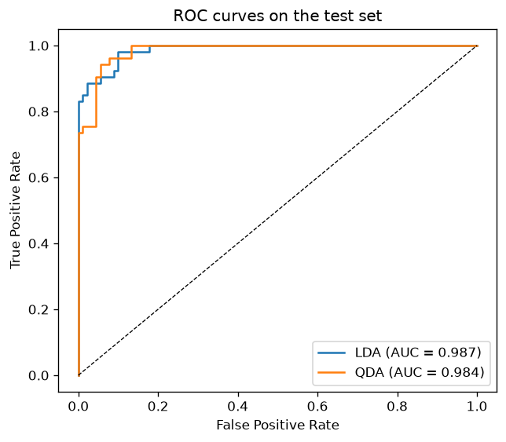
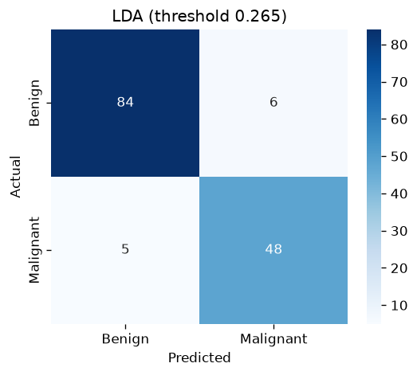
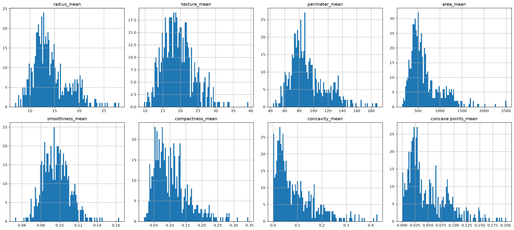
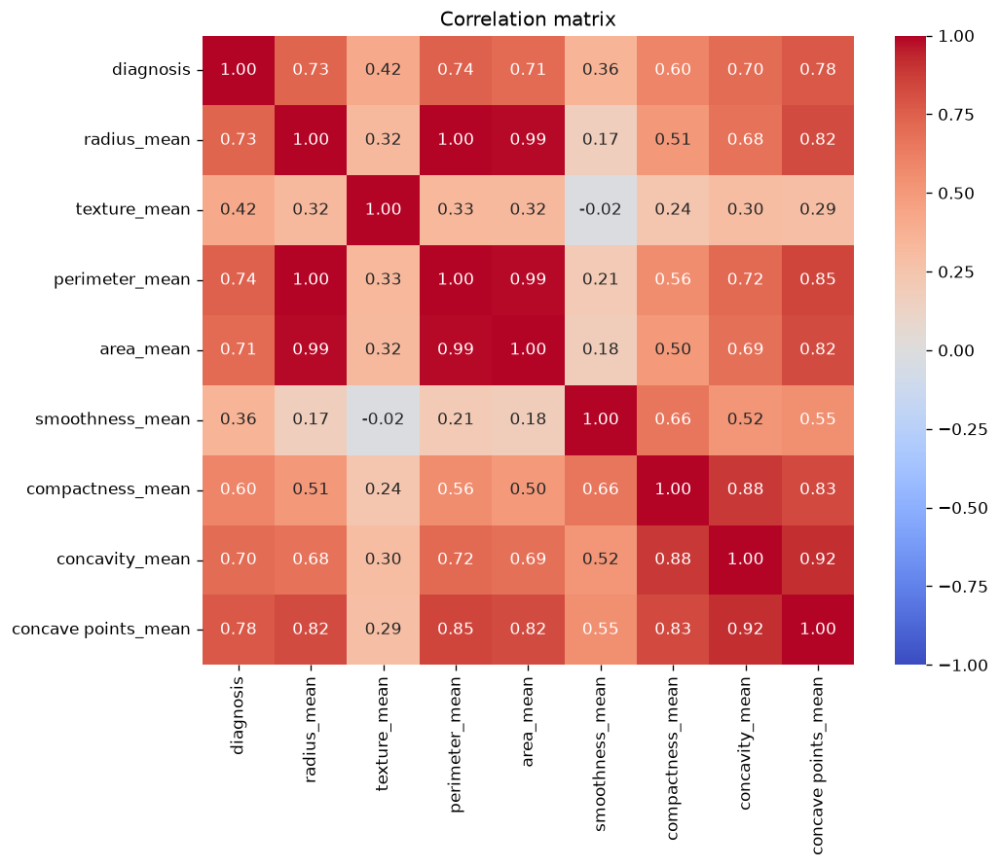
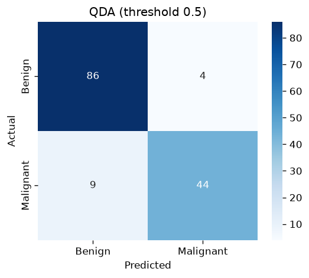

# Breast Cancer Classification with LDA and QDA

Classifying breast tumour cells as **malignant** or **benign** with **Linear Discriminant Analysis (LDA)** and **Quadratic Discriminant Analysis (QDA)**, using cell-nucleus measurements from the Wisconsin Diagnostic Breast Cancer (WDBC) dataset.

This was the Group 7 project for *Introduction to Mathematical Modelling* in the Undergraduate Program in Mathematics at Universitas Gadjah Mada (UGM).

<p align="center">
  
  
</p>

## Highlights

- Screened features with statistical tests: **D'Agostino–Pearson** for normality, then **Kruskal–Wallis** in place of one-way ANOVA because no feature was normally distributed.
- Compared two Gaussian generative classifiers: LDA, where the classes share one covariance matrix, and QDA, where each class has its own.
- **Tuned the decision threshold** for the clinical setting. Lowering it from 0.5 to 0.265 cut missed malignant cases from 8 to 5 out of 53.
- LDA scored **ROC AUC 0.987** and **93.7% accuracy** on the held-out test set.

## Results

Test set: 143 samples (25% stratified split, `random_state=17`).

| Model | Threshold | Accuracy | Sensitivity (malignant) | Specificity (benign) | Precision (malignant) | ROC AUC | False negatives |
|---|---|---|---|---|---|---|---|
| LDA | 0.5 | **0.937** | 0.849 | **0.989** | **0.978** | **0.987** | 8 |
| **LDA (final)** | **0.265** | 0.923 | **0.906** | 0.933 | 0.889 | **0.987** | **5** |
| QDA | 0.5 | 0.909 | 0.830 | 0.956 | 0.917 | 0.984 | 9 |

**Final model: LDA with threshold 0.265.** In screening, missing a malignant tumour is far more costly than a false alarm. The lower threshold raises sensitivity from 85% to 91% and costs 1.4 points of accuracy.

**Stratified 5-fold cross-validation** (addendum, full dataset):

| Model | Accuracy | Sensitivity | ROC AUC |
|---|---|---|---|
| LDA | 0.930 ± 0.026 | 0.858 ± 0.071 | 0.983 ± 0.011 |
| QDA | 0.919 ± 0.028 | 0.858 ± 0.059 | 0.981 ± 0.010 |

LDA still comes out slightly ahead. The two models are close, which is consistent with the shared-covariance assumption being reasonable for this data.

## Method

### Data

[WDBC](https://archive.ics.uci.edu/dataset/17/breast+cancer+wisconsin+diagnostic) has 569 samples: 357 benign and 212 malignant. Each sample has 30 features computed from a digitised image of a fine-needle aspirate of a breast mass. As in the original project, only the 8 **mean** features are used:

`radius_mean`, `texture_mean`, `perimeter_mean`, `area_mean`, `smoothness_mean`, `compactness_mean`, `concavity_mean`, `concave points_mean`

The dataset has no missing values. The notebook loads it from `sklearn.datasets.load_breast_cancer`, so no download is needed. The rows match the Kaggle `Cancer_Data.csv` used originally, so all results reproduce exactly.

<p align="center"></p>

### Feature screening

1. **Normality.** The D'Agostino–Pearson K² test rejects normality for all 8 features (every p < 10⁻⁶).
2. **Association with diagnosis.** Because no feature is normal, the non-parametric **Kruskal–Wallis H-test** replaces one-way ANOVA. All 8 features differ significantly between benign and malignant samples (every p < 10⁻¹⁸).
3. **Correlation.** Every feature has a Pearson correlation above 0.1 with `diagnosis`. They range from 0.36 for `smoothness_mean` to 0.78 for `concave points_mean`. All 8 features are kept.

<p align="center"></p>

### Models

Both models assume that, within class $k$, the features follow a multivariate Gaussian $\mathcal{N}(\mu_k, \Sigma_k)$. They then classify with Bayes' rule using class priors $\pi_k$.

- **LDA** uses one covariance matrix $\Sigma$ for both classes. The discriminant is then linear in $x$:

  $$\delta_k(x) = x^\top \Sigma^{-1}\mu_k - \tfrac{1}{2}\mu_k^\top \Sigma^{-1}\mu_k + \log \pi_k$$

- **QDA** gives each class its own $\Sigma_k$. The discriminant is then quadratic in $x$:

  $$\delta_k(x) = -\tfrac{1}{2}\log|\Sigma_k| - \tfrac{1}{2}(x-\mu_k)^\top \Sigma_k^{-1}(x-\mu_k) + \log \pi_k$$

QDA has more parameters, about $2 \times 36$ covariance entries instead of 36, so it can overfit when there are only 426 training samples. The features are also strongly collinear. Radius, perimeter and area are almost functions of one another, with correlations above 0.98, which makes each class covariance close to singular.

### Evaluation

The models are evaluated with accuracy, sensitivity (malignant recall), specificity (benign recall), precision, ROC curves with AUC, and confusion matrices.

<p align="center">
  
  
  
</p>

## Repository structure

```
.
├── notebooks/
│   └── breast_cancer_lda_qda.ipynb   # full analysis (executed, with outputs)
├── figures/                          # plots generated by the notebook
├── report/
│   └── breast_cancer_lda_qda_report.pdf   # original course report
├── requirements.txt
├── LICENSE
└── README.md
```

## Running it

```bash
git clone https://github.com/Peanut2Butter9/breast-cancer-lda-qda.git
```

```bash
cd breast-cancer-lda-qda && python -m venv .venv && source .venv/bin/activate
```

```bash
pip install -r requirements.txt
```

```bash
jupyter notebook notebooks/breast_cancer_lda_qda.ipynb
```

Running the notebook regenerates every figure in `figures/`.

## Limitations and what I'd do differently

- **The threshold was chosen on the test set.** The 0.265 threshold was picked by inspecting the test-set ROC curve, so the test metrics for the tuned model are optimistic. A cleaner approach is to choose the threshold with cross-validation on the training data only.
- **The "validation" step reused training data.** The final step of the original project predicts on a 25% subset of the training set. The model had already seen those samples, so the step only shows the predicted class proportions (40 of 107 predicted malignant, 37.4%). It does not measure generalisation. The cross-validation addendum is the better estimate.
- **Collinear features.** Radius, perimeter and area carry almost the same information. Regularised QDA (`reg_param`), shrinkage LDA, or PCA would handle this better. Recent scikit-learn versions refuse to fit QDA on this data by default, so the notebook sets `tol=1e-12` to reproduce the original behaviour.
- **Small test set.** With 143 test samples, one misclassification changes accuracy by 0.7 points, so the gaps between models are within noise. The CV standard deviations confirm this.
- **Only 8 of 30 features.** The `_se` and `_worst` features were dropped for simplicity. With all 30 features plus regularisation, the models would probably do better.

## Notes on the original report

The PDF in [`report/`](report/) is the version submitted for the course. While rebuilding the notebook, I found a few inconsistencies between the report and the code. The code and this README are correct.

- **Section 4.2 swaps the two LDA results.** In the report, the default threshold of 0.5 is shown with 92.3% accuracy and the tuned 0.265 threshold with 93.7%. It is the other way around. The tuned threshold gives **higher sensitivity and lower accuracy**, as the table above shows.
- **Section 3.3.2 says two features were dropped.** It states that `texture_mean` and `smoothness_mean` were removed for having a correlation below 0.1. In fact their correlations are 0.42 and 0.36, and the notebook trains on all 8 features.
- **Section 4 mentions "four models".** Only two models were compared, LDA and QDA.
- **Figure 9 has the wrong caption.** It is labelled "Logistic Regression" but shows QDA.

## Team

Group 7, *Introduction to Mathematical Modelling*, Department of Mathematics, Universitas Gadjah Mada

- Hening Arum Yudha
- Manda Marwa Twandika
- Moh Hasbi Alfarizi
- Rafa Pavita Taputri
- Yossaliano Andreas

## References

1. Wolberg, W., Mangasarian, O., Street, N., & Street, W. (1993). *Breast Cancer Wisconsin (Diagnostic)*. UCI Machine Learning Repository. https://doi.org/10.24432/C5DW2B
2. Hastie, T., Tibshirani, R., & Friedman, J. (2009). *The Elements of Statistical Learning* (2nd ed.), §4.3 Linear Discriminant Analysis. Springer.
3. Google for Developers. *Classification: ROC and AUC*. Machine Learning Crash Course. https://developers.google.com/machine-learning/crash-course/classification/roc-and-auc
4. Further references are listed in the [original report](report/breast_cancer_lda_qda_report.pdf).
